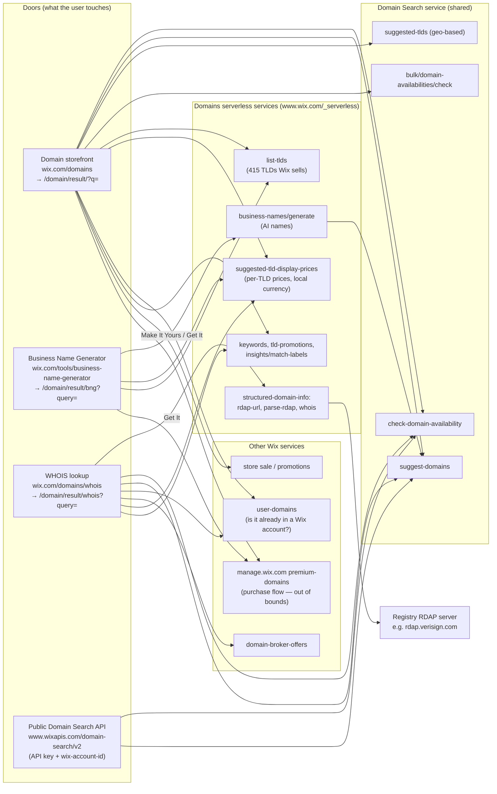

# Architecture: Wix Domains "Can I get this name?" Doors

How the four doors are built, which network calls they make, what each call drives on the
screen, and how they connect. Written for the QA engineer and the automation engineer, who
build on it in later phases.

**How this was gathered:**
- Browser developer tools (network capture and in-page request inspection) on the three web doors, on 2026-11-03.
- The Wix REST docs, for the public API.
- Visitor location: **Israel**, logged in to my own Wix account. Prices showed in **₪ (ILS)**, and `.co.il` was suggested. See "Location-dependent behaviour" below.

> Endpoint paths below are internal and observed, not a documented contract. They can change
> without notice, which is why automated UI tests should assert on what the user sees, not on
> these internal calls.

---

## 1. The big picture

All three web doors are **pages on www.wix.com built with Wix's own site platform**:
- The pages report themselves as "Wix.com Website Builder" and run on Wix's own page renderer, served from `static.parastorage.com`.
- They use React 18.

Each door has a **landing page** (marketing content and a search box) and a **results page** under `/domain/result/...` that does the real work.

The key finding: **the web doors and the public API share the same Domain Search service.**
- The storefront and WHOIS pages call `www.wix.com/domain-search/v2/...`. These are the same paths as the public API at `www.wixapis.com/domain-search/v2/...`.
- The web doors authenticate with the visitor's browser session (cookies plus an `X-XSRF-TOKEN` header).
- The public API authenticates with an account-level API key.

---

## 2. Door by door

### 2.1 Domain storefront: `https://www.wix.com/domains`

**What it's made of:**
- A marketing landing page with a search box and TLD chips (`.com`, `.org`, `.co`, `.net`, `.ai`, `.shop`).
- Submitting a search goes to the results page `https://www.wix.com/domain/result/?q=<input>`.
- The results page loads data with XHR calls to same-origin endpoints.

**Network calls on the results page, and what each one drives on screen:**

| # | Call | Method | When | Drives on screen |
|---|---|---|---|---|
| 1 | `/_serverless/premium-domains-serverless/domain-tlds/list-tlds` | GET | Page load | The list of TLDs Wix sells (415 at capture time, registrars `TUCOWS` and `WIX`). Used to decide whether a TLD is purchasable. |
| 2 | `/_serverless/domains-serverless-services/v1/suggested-tld-display-prices` | POST | Page load | **Every price on the page.** Per-TLD `price`, `originalPrice` (the struck-through price), `renewalPrice` and `pricingStrategy` (`FREE_FIRST_YEAR`, `MULTI_YEAR_MINIMUM_COUNT`, `RENEWAL`), already formatted in local currency (e.g. `₪0.00`). Also `pricesExcludeTax`. |
| 3 | `/store/api/v1/sale/<id>` | GET | Page load | The promotion banner ("Get a domain free for 1 year with any annual site plan"). |
| 4 | `/domain-search/v2/check-domain-availability?domain=<input>` | GET | Input includes a TLD | **The main answer card:** "Exact Match · Available now!" with price and "Make It Yours", or the message "`<domain>` is already registered. Explore some great alternatives below." |
| 5 | `/_api/user-domains/v1/user_domains/<domain>` | GET | Input includes a TLD | Whether the domain is already in a Wix account. `404 DOMAINS_NOT_FOUND` for a free name. **`403 DOMAINS_PERMISSION_DENIED: domainBelongsToDifferentUser` for `google.com` and `facebook.com`**, which aren't Wix domains. See testing notes. |
| 6 | `/domain-search/v2/suggest-domains?query=<input>&paging.limit=50` | GET | Always | **The "alternatives" list** (and both hero cards when there's no TLD). Returns `suggestions[] {domain, premium}`. Every suggestion is meant to be available. |
| 7 | `/domain-search/v2/suggested-tlds` | GET | Name is taken | An ordered TLD list based on location. `co.il` was 3rd for an Israeli visitor. |
| 8 | `/domain-search/v2/bulk/domain-availabilities/check` | POST | Name is taken | Checks the same name on the suggested TLDs (e.g. `{"domains":["facebook.net","facebook.co.il",…]}`), in several batches. Returns `results[] {itemMetadata, item {domain, available, premium, premiumType}}`. Feeds the "same name, other ending" options. |
| 9 | `/_serverless/domains-serverless-services/v1/keywords`, `/tld-promotions` | GET | Page load | Filter keywords and TLD descriptions ("Most popular domain for businesses…"). |
| — | `frog.wix.com`, `panorama.wixapps.net`, ad pixels | POST | Throughout | Analytics only, nothing on screen. |

**Flow by input type:**

| Input | Calls | Screen |
|---|---|---|
| Name with TLD, available (`qa-wix-1793700000.com`) | 4 → `available:true`, 5 → 404, 6 | Exact-match card plus alternatives in other TLDs |
| Name with TLD, taken (`google.com`) | 4 → `available:false`, 5 → 403, 7, 8 (×3), 6 | "already registered" message, two hero cards ("Great Alternative", "Recommended") and an alternatives list. **Skeleton loaders for several seconds**; `suggest-domains` took about 8 s in one capture. |
| Name without TLD (`qa-wix-1793700000`) | 6 only | "Best Match" (`.com`) and "Great Alternative" (`.co.il`) cards plus a list. No availability call, because suggestions are already available. |

**Path to purchase (boundary):**
- "Make It Yours" or "Get It" goes to `https://manage.wix.com/premium-domains/desktop-split-page?domainName=<domain>`, a page titled "Domain Purchase".
- **We stop here.** Nothing past this page is tested.

### 2.2 Business Name Generator: `https://www.wix.com/tools/business-name-generator`

**What it's made of:**
- A landing page with a free-text "Describe your business" box and a "Generate Names" button.
- Submitting goes to `https://www.wix.com/domain/result/bng?query=<description>`. The full description is placed in the URL.
- The results page shows a two-step layout: (1) choose a business name on the left, (2) pick a domain for it on the right.

**Network calls and what they drive:**

| # | Call | Method | Drives on screen |
|---|---|---|---|
| 1 | `/_serverless/domains-serverless-services/v1/business-names/generate` | POST | **The list of business names** on the left. Request: `{"query":"<description>","excluding":[names already shown],"count":9}`. Response: `businessNames[] {id, name, reasoning}`. The `reasoning` appears as a tooltip (e.g. "Evokes freshness and warmth of homemade sourdough"). "Generate more names" calls it again with the earlier names in `excluding`. About 2.6 s. |
| 2 | `/domain-search/v2/suggest-domains?query=<selected name>&paging.limit=50` | GET | **The domain list** on the right for the selected name (e.g. `doughluxe.co.il`, `dough-luxe.com`, `doughluxe-bakery.com`). Called again each time a different name is clicked. |
| 3 | `list-tlds`, `suggested-tld-display-prices` | GET/POST | Prices and purchasability, same as the storefront. |

**Important for testing:**
- Only the **selected name** is sent to `suggest-domains`, not the business description.
- For the name "Rise" (description: a sourdough bakery), the domains returned were `traprise.com`, `slaprise.com`, `allfundrise.com`, `fundadvanceinc.com`. They have nothing to do with a bakery.
- The Name Generator doesn't call `check-domain-availability`. It relies on suggestions being available.

### 2.3 WHOIS lookup: `https://www.wix.com/domains/whois`

**What it's made of:**
- A landing page with "Enter a domain name or URL".
- Submitting goes to `https://www.wix.com/domain/result/whois?query=<input>`.
- The results page has two columns: WHOIS information on the left, and "Explore these great alternatives" (domains to buy) on the right.

**Network calls and what they drive:**

| # | Call | Method | Drives on screen |
|---|---|---|---|
| 1 | `/_serverless/domains-serverless-services/v1/structured-domain-info/rdap-url?domain=<d>` | GET | Finds the registry's RDAP server for the TLD. For `.com`: `{"url":"https://rdap.verisign.com/com/v1/"}`. |
| 2 | Registry RDAP server (e.g. `rdap.verisign.com`) | GET | **Called directly from the browser**, outside Wix. Returns the raw registration record. |
| 3 | `/_serverless/.../structured-domain-info/parse-rdap` | POST | Turns the RDAP record into the **"Domain Information"** section: Created, Updated, Expires, Nameservers, Domain Status. Called twice in the capture. |
| 4 | `/_serverless/.../structured-domain-info/whois?domain=<d>&parse=false` | GET | Raw WHOIS text from the registry (`info.raw.registry`), plus `registrant.redacted: true`. Feeds the **"Registrar Information"** section and the redacted registrant. |
| 5 | `/domain-search/v2/check-domain-availability?domain=<d>` | GET | **The status banner:** "`google.com` is taken. A broker might be able to get it for you." |
| 6 | `/v1/domain-broker-offers/query` | GET | The broker offer link in the banner. |
| 7 | `/_api/user-domains/v1/user_domains/<d>` | GET | Whether the domain is already in a Wix account (same as the storefront). |
| 8 | `/domain-search/v2/suggest-domains?query=<d>&paging.limit=5` | GET | **The "alternatives" column** (5 items, e.g. `realgoogle.net`, `realgoogle.biz`, `googlelive.biz`). |
| 9 | `/_serverless/.../insights/match-labels` | POST | The labels on the alternatives ("Great Alternative", "Best for Commerce", "Ready to Grow"). About 1.5 s. |
| 10 | `suggested-tld-display-prices`, `list-tlds`, `keywords`, `tld-promotions` | — | Prices and TLD data for the alternatives column. |

**Example (`google.com`):** Created September 15, 1997; Updated September 9, 2019; Expires September 14, 2028; nameservers `ns1–ns4.google.com`; six "Prohibited" status flags. The registrant is redacted, which is expected.

### 2.4 Public Domain Search API

| Method | Endpoint | Notes |
|---|---|---|
| Check Domain Availability | `GET https://www.wixapis.com/domain-search/v2/check-domain-availability?domain=<name.tld>` | `domain` must include the TLD; 3–63 characters; letters, digits, hyphens and dots. Response: `availability {domain, available, premium, premiumType}`. `premiumType` is `FIRST_YEAR_ONLY` or `FIRST_YEAR_AND_RENEWAL` (or `UNKNOWN_PREMIUM_TYPE` when not premium). |
| Suggest Domains | `GET https://www.wixapis.com/domain-search/v2/suggest-domains?query=<text>&tlds=<tld>&paging.limit=<n>` | `tlds` without the dot (`com`, not `.com`). Response: `suggestions[]`, `pagingMetadata {count, cursors, hasNext}`. |

- **Auth:** `Authorization: <account-level API key>` and `wix-account-id: <account id>`. The docs say it "cannot be authenticated with the standard authorization header" (site-level auth).
- **Verified:** `check-domain-availability?domain=google.com` returned HTTP 200 and `available:false`.
- **Not in the public API:** prices, the TLD list, bulk availability and suggested TLDs. These exist only on the web doors' internal endpoints.

---

## 3. How the doors relate

| Capability | Storefront | Name Generator | WHOIS | Public API |
|---|---|---|---|---|
| Availability check (single) | ✅ `check-domain-availability` | ❌ | ✅ same call | ✅ same endpoint |
| Bulk availability (same name, other TLDs) | ✅ when taken | ❌ | ❌ | ❌ |
| Suggestions | ✅ `suggest-domains` (limit 50, query = user input) | ✅ `suggest-domains` (limit 50, query = **generated name**) | ✅ `suggest-domains` (limit 5) | ✅ same endpoint |
| Prices | ✅ per-TLD price table | ✅ same | ✅ same | ❌ (only a `premium` flag) |
| AI name generation | ❌ | ✅ `business-names/generate` | ❌ | ❌ |
| Registration data | ❌ | ❌ | ✅ RDAP + WHOIS | ❌ |
| "Already in a Wix account" check | ✅ `user-domains` | ❌ | ✅ `user-domains` | ❌ |
| Purchase handoff | ✅ → manage.wix.com | ✅ → manage.wix.com | ✅ → manage.wix.com | ❌ |
| Auth | Browser session + XSRF | Browser session | Browser session | API key + account ID |

**What this means:**
1. **One source of truth for availability.** The storefront, WHOIS and the API all use `check-domain-availability`, so for the same name at the same moment they should agree. If they don't, it's a real bug (cache, location or proxy differences).
2. **Suggestions come from one engine** with different inputs and limits per door. Different suggestions between doors are expected (and noted as expected in the requirements), but every suggestion should be available and in a TLD Wix sells.
3. **Prices are per TLD, not per domain.** The price table has no per-domain premium price, so how premium prices get onto the screen needs checking in Phase 2.
4. **The API is a thinner view:** availability, a premium flag and suggestions only. No prices, no "already in a Wix account" check, no TLD list.

---

## 4. Location-dependent behaviour (observed from Israel)

| What | Observed | Why it matters |
|---|---|---|
| Currency | All prices in ₪ (ILS) | Tests must not hard-code a currency or amount. |
| Suggested TLDs | `co.il` ranked 3rd in `suggested-tlds`; `.co.il` shown as a hero "Great Alternative" | Different results outside Israel are expected. |
| Pricing example (.com) | `price ₪0.00`, `originalPrice ₪21.47`, `renewalPrice ₪90.19`, `FREE_FIRST_YEAR` | See testing note 3. |
| `list-tlds` | `geoFilteringDisabled: false` | The TLD list itself may be filtered by location. |

---

## 5. Testing notes (handoff to the QA engineer and the automation engineer)

**Risky areas and observations to investigate.** These are not confirmed bugs, and each one needs checking against "Domain basics" first.

1. **Taken domains reported as belonging to "another Wix account".** For `google.com` and `facebook.com`, `user-domains` returned `403 domainBelongsToDifferentUser`, and the storefront's analytics event recorded `result=DOMAIN_IN_ANOTHER_WIX_ACCOUNT` / `domainTakenInWix`. The screen showed the correct "already registered" message. To check: does any taken domain get classified as Wix-owned? Does it change the message or offers shown, and does it skew business data?
2. **Name Generator domain relevance.** Suggestions are based only on the short generated name, not the business description. "Rise" for a bakery returned funding-related domains. This is a user-experience risk, not a correctness bug, since suggestions are allowed to vary.
3. **Struck-through price vs renewal price.** For `.com` the struck-through "original" price was ₪21.47, but the renewal price was ₪90.19. To check: is it clear to the user what they pay from year 2?
4. **Slow results for taken names.** `suggest-domains` took about 8 s on the storefront for `google.com`, with skeleton loaders on screen. Possible timeout or abandonment risk; automation needs generous waits.
5. **Unsold TLDs for test data.** Not in `list-tlds` at capture time: `.de`, `.eu`, `.ru`, `.cn`, `.il`. In the list: `.com`, `.co.il`, `.io`, `.ai`, `.xyz`.
6. **Business description in the URL.** The Name Generator places the full free-text description in the query string (`/domain/result/bng?query=…`). This is a minor privacy and analytics observation.

**What to assert on (stable):**
- UI: the answer text on the main card ("Available now!" / "is already registered"), the domain name shown, that a price and a buy button exist, and the WHOIS field labels (Created, Expires, Nameservers).
- API: HTTP status, `availability.available` (boolean), `availability.domain` equal to the input, `premiumType` from the allowed set, and the suggestions array being non-empty and valid hostnames.

**What not to assert on (changes over time or location):** exact suggestions, their order or count, exact prices or currency, hero-card labels, promotion banners.

**Useful URLs for direct navigation in tests:**
- Storefront results: `https://www.wix.com/domain/result/?q=<domain>`
- WHOIS results: `https://www.wix.com/domain/result/whois?query=<domain>`
- Name Generator results: `https://www.wix.com/domain/result/bng?query=<description>`

**Page elements found during capture:**
- Storefront results search box: a textbox holding the current query, under the heading "Lock in your domain. Start your online journey."
- WHOIS landing input: placeholder "Enter a domain name or URL".
- Name Generator: textbox with placeholder "e.g. I own a small catering company…" and a "Generate Names" button.
- Buy buttons: "Make It Yours" on hero cards, "Get It" in lists.
- Prefer role- and text-based locators over CSS classes, which are generated.

**Boundaries:** the purchase flow starts at `manage.wix.com/premium-domains/...`. Don't go past that page.
